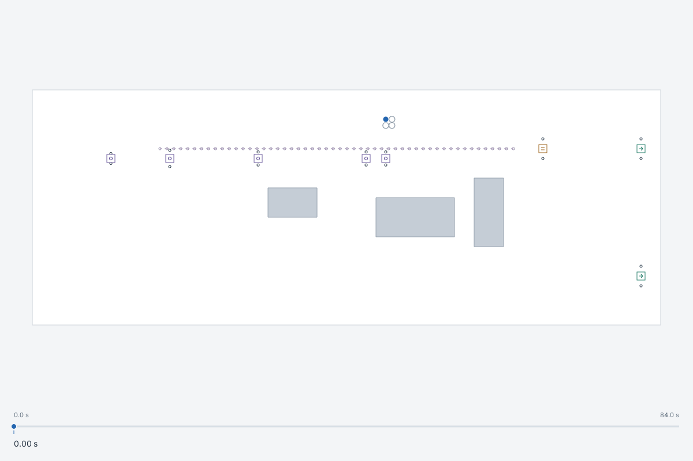

<h1 align="center"><code>Chiyoda</code></h1>

<p align="center"></p>

<p align="center"><em>A deterministic simulator for Pedestrian-flow</em></p>

<p align="center">
  <a href="https://github.com/gongahkia/chiyoda/releases/tag/1.0.0"></a>
  <a href="https://github.com/gongahkia/chiyoda/actions/workflows/verify.yml/"></a>
</p>

## What is Chiyoda?

`Chiyoda` is a [deterministic](#features) 2D/3D [pedestrian-flow](https://www.researchgate.net/figure/Examples-of-pedestrian-flow-data_tbl1_366989142) simulator with [versioned JSON scenarios](#the-chiyoda-scenario-format).

## Features

* **Text-first**: Author geometry, demand, routes, capacities, and state changes in JSON with SI units encoded in field names
* **Deterministic**: Run the same valid scenario with the same runtime and get the same result
* **Inspectable**: Format, validate, run, and replay from the command line
* **Reproducible**: Runs include their source and a hash-verifiable `run.json` bundle

## GIFs



## The `Chiyoda` scenario format

Below is a simple example of a validated JSON scenario. See [`docs/scenarios.md`](./docs/scenarios.md) for a more detailed scenario specification.

`Chiyoda` scenarios use the `.json` file extension.

```json
{
  "schema_version": "1",
  "scenario": {
    "name": "concourse-transfer",
    "seed": 73,
    "duration_s": 120.0,
    "timestep_s": 0.1,
    "surfaces": [
      {"depth_m": 16.0, "id": "platform", "origin": {"x_m": 0.0, "y_m": 0.0, "z_m": 6.0}, "width_m": 40.0},
      {"depth_m": 16.0, "id": "concourse", "origin": {"x_m": 0.0, "y_m": 0.0, "z_m": 0.0}, "width_m": 40.0}
    ],
    "obstacles": [
      {"at": {"x_m": 18.0, "y_m": 6.0, "z_m": 0.0}, "depth_m": 4.0, "id": "retail_kiosk", "surface": "concourse", "width_m": 4.0}
    ],
    "waypoints": [
      {"at": {"x_m": 28.0, "y_m": 8.0, "z_m": 0.0}, "dwell_s": 5.0, "id": "fare_hall", "surface": "concourse"}
    ],
    "exits": [
      {"at": {"x_m": 40.0, "y_m": 8.0, "z_m": 0.0}, "capacity_per_s": 3.0, "id": "street", "surface": "concourse", "width_m": 3.0}
    ],
    "connectors": [
      {"Stair": {
        "capacity_per_s": 1.5,
        "clearance_height_m": 2.1,
        "from": {"x_m": 24.0, "y_m": 8.0, "z_m": 6.0},
        "from_surface": "platform",
        "id": "north_stair",
        "to": {"x_m": 24.0, "y_m": 8.0, "z_m": 0.0},
        "to_surface": "concourse",
        "width_m": 2.0
      }}
    ],
    "gates": [
      {"at": {"x_m": 32.0, "y_m": 8.0, "z_m": 0.0}, "destination": "street", "id": "fare_gate", "service_rate_per_s": 18.0, "surface": "concourse", "width_m": 2.0}
    ],
    "agents": [
      {
        "at": {"x_m": 8.0, "y_m": 8.0, "z_m": 6.0},
        "count": 120,
        "destination": "street",
        "height_m": 1.7,
        "id": "passengers",
        "radius_m": 0.3,
        "release_at_s": 0.0,
        "speed_mps": 1.2,
        "surface": "platform",
        "via": ["fare_hall"]
      }
    ]
  }
}
```

## Usage

> [!NOTE]  
> `Chiyoda` uses [Rust 1.98.0](https://releases.rs/docs/1.98.0/) through `rust-toolchain.toml`.

The below instructions are for running `Chiyoda` locally.

1. First clone `Chiyoda` to your machine.

```console
$ git clone https://github.com/gongahkia/chiyoda.git && cd chiyoda
```

2. Next execute the below to build `Chiyoda`'s scenario CLI and its native replay viewer *(currently only supported on Linux Display Servers)*.

```console
$ cargo build --release --workspace --locked
$ export PATH="$PWD/target/release:$PATH"
```

3. Finally, run any of below commands to use `Chiyoda`'s functionality.

```console
$ chiyoda generate --seed 73 -o example.json
$ chiyoda format example.json -o example.formatted.json
$ chiyoda check example.formatted.json
$ chiyoda run example.formatted.json -o out/example
$ chiyoda replay out/example/run.json
```

## Reference

The name `Chiyoda` is in reference to the [Tokyo Metro Chiyoda Line](https://en.wikipedia.org/wiki/Tokyo_Metro_Chiyoda_Line) and the [1995 Tokyo Subway Sarin Attack](https://en.wikipedia.org/wiki/Tokyo_subway_sarin_attack) enacted by the [Aum Shinrikyo](https://en.wikipedia.org/wiki/Aum_Shinrikyo) Cult.

<div align="center">
    
</div>
