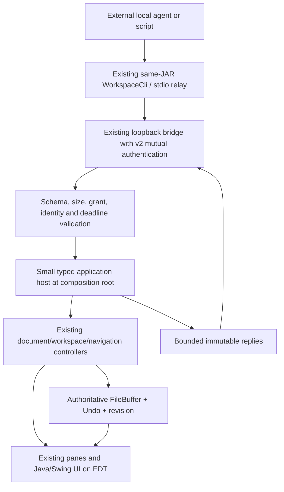

# Track A0 — Local agent-control-plane architecture audit

## A. Executive decision

**CONDITIONAL GO for a small local-control implementation.** Shed already has a headless workspace CLI, an explicitly enabled live-editor bridge, private endpoint descriptors, source-version checks and application-facing document interfaces. Extend those boundaries. A second editor, document store, Undo engine, IPC framework or platform port is unnecessary.

This is an architecture decision, not qualification of a shipped control plane. A0 changed documentation and evidence only. No control listener, production GUI application, real language server, interactive shell, agent-driven source edit or native capture was started for this audit. Existing headless tests edit disposable documents and paint components in memory. The existing bridge is not yet a sufficient implementation of the proposed interface. In particular:

1. Authenticate the application before disclosing a reusable credential or accepting editor state. The present client sends a bearer token before establishing server identity.
2. Add bounded metadata access. The present live workspace snapshot adapter reconciles every buffer on the EDT and materializes full source, even for operations that ultimately return metadata.
3. Specify window/pane/grant identity, source revisions and human-context checks before exposing navigation.
4. Qualify mode-aware selection and bounded coordinate validation. Existing clamping helpers are not external input validators.
5. Prove real CLI-to-application attachment through a separately admitted desktop acceptance path. In-process tests are not native desktop acceptance; B0.1's native-shell positive control remains failed.

The smallest first task is **A1a: harden attachment and expose status only**, using the existing same-JAR CLI and bridge. Require explicit attachment and human opt-in; defer discovery convenience, document source, navigation, editing, screenshots and tool execution. General public-release readiness remains outside A0 and retains the existing Unicode, preview, native-memory and platform qualifications.

Evidence: [A0 index](performance/agent-tracka0/INDEX.md), including source locations/hashes and safely executed tests. Findings below are source-inspected unless explicitly identified as executed tests, historical measurements or proposals. All new command names, schemas, budgets and tranches below are **proposals, not implemented features**.

## B. Existing capability and ownership map

Paths in this table are relative to `src/main/java/shed/`. Exact symbol locations and supporting test paths are indexed in [source-map.json](performance/agent-tracka0/source-map.json).

| Boundary | Actual interfaces and behavior | Reuse and limitation |
|---|---|---|
| Entry/CLI | `Texteditor.main(String[])` short-circuits to `WorkspaceCli.handles/run` for first argument `--workspace-api`; `scripts/shed` invokes the existing JAR. | Same Java entry point suffices; no separate native CLI binary. Ordinary arguments are startup paths, not `open` or `ctl` subcommands. |
| Existing external interface | `WorkspaceCli.run(String[], InputStream, OutputStream, OutputStream)` supports `--root`, `--connect`, `--request`, `--stdio`. Without connect it queries disk; with connect it attaches to the live bridge. | An existing Shed process **can** receive explicit workspace requests. This is not yet cursor/pane control. |
| App lifecycle | `Texteditor.openStartupTargets(String[], long)` queues startup paths; startup performance events mark window-visible/editor-usable/full-UI-ready/files-installed. `closeEditor()` closes resources and ultimately exits the process. | No public readiness future or stable process/window registry. Normal wrapper invocation starts another JVM; no automatic singleton forwarding or verified desktop open-file event handler. Multiple window objects do not establish independently managed multi-window process lifecycle. |
| Bridge lifecycle | `AgentWorkspaceController.handle(String)` exposes `:agent api start`, `api start propose`, `api status`, `api stop`; `close()` retires sessions/bridges. | Explicit activation already exists, off until requested. Start captures one root; it does not follow active-project changes. Do not add another manager or listener alongside it. |
| Transport | `WorkspaceBridgeServer`, `WorkspaceBridgeClient`, `WorkspaceBridgeEndpoint`, `WorkspaceFrames`, `WorkspaceRpc`. IPv4 loopback socket and private JSON descriptor. | Shared portable foundation. Authentication, correlation and capability isolation need the gates in D/H. |
| Root ownership | `WorkspaceController.roots()/activeRoot()/addFolder(Path,boolean)/removeFolder(Path)/activateFolder(Path,boolean)` and `WorkspaceRoots`. Several folders may be configured. | Configured roots and active tree root are not permission grants. An active file can belong to a different configured root. No first-MVP command changes project roots. |
| Execution context | `RemoteWorkspaceSessionService.connectionFor(Path)` and `DevContainerSessionService.connectionFor(Path)` identify existing path-scoped remote/container connections. | A local mirror path does not imply ordinary local execution semantics. Initial navigation/file-open scope excludes active remote/container contexts; do not inherit connection/tool permissions from a local path grant. |
| Path policy | `WorkspacePaths.root(Path)`, `resolve(Path,String)`, `id(Path)`; `WorkspaceRootResolver.configuredRoot/normalizedIdentity`. | Machine requests should use the strict paths/policy boundary, not the resolver's best-effort fallback after I/O failure. Root ID hashes the canonical path URI; it is not authorization or an inode/lifetime identity. |
| Document facade | `DocumentWorkspace` declares `documents`, `activeDocument`, `activate(Id)`, `open(Path,int,int,String)`, `activeSurface`, `navigate`, roots and existing editing/lifecycle operations. `DocumentWorkbench` delegates to `SwingWorkbenchHost`. | Existing application-facing seam; only expose explicitly allowed methods. Save/close/split/Undo are not implicitly authorized by exposing this facade. Returned open/save messages mean queued work, not completed I/O. |
| Source owner | `FileBuffer.getDocument()` returns the authoritative `PlainDocument`; `documentRevision()`, `isModified()`, `getUndoManager()`, save/recovery and snapshot support belong to that buffer. | Shared splits use the same buffer, document and history. No independent agent source state. Partial large-file projections are not complete editable source. |
| Internal identity | `LegacyDocumentStore.id(FileBuffer)` gives `DocumentWorkspace.Id(long)`; `describe` produces metadata without full source. | Store/window-lifetime ID, not persistent file identity. Close/reopen is a new document. |
| Existing wire identity | `EditorWorkspaceDocuments.snapshots()` exposes `buffer-<UUID>` IDs and opaque `editor-…` versions through `WorkspaceDocument`. | Reuse its identity registry through bounded accessors, not a second registry of source text. Opaque snapshot versions are not raw source revisions. |
| Pane/source surface | `EditorPane`, `EditorSurface`, `SwingEditorSurface`; `EditorUiController.activateEditorPane` and existing pane-focus helpers. `EditorSurface` has directed selection, viewport, select/scroll/focus and separate mutation methods. | EDT-only presentation access. No stable wire pane ID currently. Active-pane tracking remains authoritative. A terminal/preview surface must not be treated as a source text pane. |
| File installation | `PaneBufferController.openFileCheckedAsync(File, BooleanSupplier, Predicate<FileBuffer>, Predicate<FileBuffer>, Runnable, Consumer<IOException>)`; `DocumentRequests` per-pane generations. | Reuse background loading and late-install checks. New caller needs a typed outcome and explicit target, context and permission checks; human-oriented strings are not protocol completion. |
| History/lifecycle | `DocumentNavigation.Location(DocumentWorkspace.Id,int)`, bounded `NavigationHistory`; `EditorPane` disposal retires callbacks and detaches its source view. | Record genuine navigations through the existing owner once. Never retain pane/component instances in protocol caches. Preserve 8G.1 callback/Undo changes. |
| Language state | `LspClient.getDiagnostics(String)`, `diagnosticsSnapshot()`, `ProblemsController.snapshot()`; B1A asynchronous definition request infrastructure. | Existing getters drain notifications; not side-effect-free cache reads. Diagnostics currently lack a retained source version. Do not start a server, drain an unbounded queue or issue definition/symbol requests from state queries. |
| Rendering | `MarkdownController.openPreview()`, `MarkdownPreviewPane.renderNow`, `MarkdownMediaRenderer`; notebook controller/panel also render existing cell outputs. | Markdown HTML preview embeds Mermaid, images and math through existing media providers. No inline rich source rendering, universal rendered-file API or qualified standalone Mermaid viewer is established here. |
| Existing AI work | `AgentWorkspaceController`, workspace queries/proposals, Assistant/provider integrations documented in `AGENT_WORKSPACE.md`. | Existing reviewed edit and approved-command facilities are separate from this MVP. ACP provider integration is not a requirement for local control. Never expose its general command executor through navigation RPC. |

### Startup, shutdown and restart

The CLI path sets Java headless mode before any editor window is constructed. Its stdio protocol belongs to the **CLI relay process**, not the GUI application's ordinary stdin/stdout. The GUI may log and does not have a general framed stdin command loop. CLI EOF closes that attachment; it is not application shutdown.

Normal startup can initiate Git/project activity, file watching, recovery prompts, update activity and language-server behavior when configured. A direct Java GUI launch is therefore not automatically safe under the current qualification restriction. Startup event names are instrumentation, not a promise that all panes, project work and first input are ready. A future typed status must expose stages, rather than infer readiness from process existence or a visible window.

`closeEditor()` and `windowClosed` already retire adapters, panes, jobs and related resources; process exit is part of normal quit. Endpoint lifetime, window lifetime and process lifetime must remain distinct. After crash/restart a descriptor may be stale. A new process needs a new process identity, endpoint generation and grants; never reconnect silently to the “newest” instance or reuse a document ID across restart. Existing recovery restores human work through existing policy, not an agent replay log.

### Documents, revisions and snapshots

`FileBuffer` owns source, dirty state, saved-content baseline, format metadata, bounded Undo and recovery. A numeric saved revision is **not** currently exposed. Report saved-baseline availability separately; do not fabricate `savedRevision = currentRevision` or hash full saved text on the EDT. Disk bytes can have original encoding, BOM and CRLF while editor coordinates refer to normalized in-memory UTF-16 source.

The snapshot adapter's `capture()` loops over all buffers, calls `reconcileDocumentText()` for ordinary documents, then `materialize()` expands snapshots into strings on the caller. Pagination or policy filtering after `snapshots()` does not bound that preparation. A high-frequency `editor/state` implementation must use targeted metadata and bounded source copying. It must not simply call existing `documents/list` repeatedly and assume it is cheap.

Scratch workspace assignment in this adapter is captured at first identity observation, not proven creation-time project ownership. Pathless/unsaved source is excluded initially unless the user grants that document explicitly. A grant to a folder is not permission to disclose every draft. Large-file projections report incomplete/read-only status; initial navigation/excerpt operations reject them rather than treating projected offsets as full-file coordinates.

## C. Proposed shared architecture



Keep transport, JSON and permission checks free of Swing references. Add a small typed host interface implemented at the existing composition root, following `DocumentWorkbench`/`SwingWorkbenchHost`. Services must not retain `Texteditor`, inspect arbitrary private components or introduce controller-to-controller ownership. The host maps only approved operations to existing controllers and captures immutable DTOs. It owns no source documents.

Filesystem identity work and protocol work run off the EDT. On the EDT, capture/recheck narrowly scoped state and perform existing UI actions. Return completion asynchronously; no EDT waits for IPC, disk, language server, client acknowledgement or worker futures. Existing `AsyncJobService` has a fixed ordinary worker count and EDT completions; reuse it for admitted file preflight/loading. Its fixed-thread executor does not itself bound submission backlog, so enforce control-specific admission before submitting tasks. Existing per-client virtual threads handle blocking transport. Do not add a general permanent control pool.

The existing `EditorWorkspaceDocuments` worker-to-EDT waits are not permission to make an EDT-to-worker wait. Pending tasks carry IDs/generations and a closed flag. Their completion must validate the owning window, pane membership, buffer identity, grant, source revision and view context before installing anything.

## D. Transport decision and attachment

| Option | Evidence and trade-off | Decision |
|---|---|---|
| Same-JAR CLI plus existing loopback bridge | Already implemented, Java standard networking, owner-private descriptor, bounded frames/clients, explicit attachment and teardown. Address restriction alone does not authenticate clients or servers. | **Recommended**, after mutual authentication/correlation and narrow grants. No HTTP server or default external listener. |
| Unix-domain socket | Java API exists, but provider support, path permissions, length, cleanup and deployment need platform qualification. It is not a uniform peer-identity solution. | Optional later adapter, not required for A1. |
| Windows named pipe | No verified existing adapter or uniformly portable named-pipe control implementation in this repository. | Do not add a native framework for A1. |
| GUI process stdin/stdout | Would couple application lifetime, logs and one launching parent; cannot attach arbitrary later clients through ordinary stdio. | Keep existing CLI stdio relay instead. |
| Existing singleton command channel | No singleton forwarding mechanism found. Startup paths launch a fresh application. | Reuse workspace bridge, not an assumed OS open-command channel. |
| File mailbox/discovery polling | Creates partial-write, replay, stale-file and polling problems without an existing advantage. | Reject as command transport. Private files are for discovery only. |

Java 21 provides Unix-domain address/channel APIs, but an address uses the default filesystem, a transport can be unsupported, Unix socket path length is implementation-dependent, and bound socket files require cleanup. These facts do not qualify a particular Windows/macOS/Linux deployment. See [Java UnixDomainSocketAddress](https://docs.oracle.com/en/java/javase/21/docs/api/java.base/java/net/UnixDomainSocketAddress.html) and [SocketChannel](https://docs.oracle.com/en/java/javase/21/docs/api/java.base/java/nio/channels/SocketChannel.html). The JEP page was unavailable during research; this decision does not depend on it.

### Current protocol and its limits

The current bridge binds `127.0.0.1`, chooses a port, and publishes a schema-1 descriptor containing root, workspace ID, endpoint UUID and a random 32-byte token. `PrivateWorkspaceFiles` implements owner-only POSIX modes or ACL handling, rejects unsuitable file types/ownership, bounds reads and checks identity around reads. Cleanup deletes a descriptor only if its bytes still match. These are useful existing protections, not an OS sandbox.

Current limits include eight clients, a 4 KiB authentication frame, approximately three seconds for authentication, 60-second idle/frame deadlines, 1 MiB request and 16 MiB response frames. Enabled operation uses an acceptor, per-client virtual tasks and a deadline executor; none is needed for a disabled endpoint. Source inspection is not a measurement of their actual retained memory or platform scheduling cost.

The client currently sends the descriptor token in the first `connection/authenticate` frame. The response echoes expected identifiers, but supplies no independent server proof. **[Inference]** a stale descriptor whose port has been reassigned can connect to an impostor, disclose the token and accept forged state. A0 did not execute an exploit. The client exchange also needs explicit request/response-ID correlation. These are concrete attachment-design gaps, not a claim that a personal file was compromised.

Before control access, version the descriptor/handshake and use fresh nonces with role-separated HMAC proofs over a fixed, canonical transcript binding protocol, endpoint, project and both nonces. Use JDK crypto, constant-time verification, deadlines and replay tests; do not transmit the secret. A security review and independent test vectors are acceptance gates, not an assertion that this suggested handshake is already secure. Never downgrade a control-capable credential to the old bearer handshake. Existing legacy read/propose compatibility must use an explicitly separate mode/key, not silently inherit control rights.

### Discovery and targeting

A1a uses an explicit owner-private descriptor path and root, as the current CLI already does. A1b may enumerate at most 32 bounded descriptors from one known private base outside every exposed root; no broadcasts, arbitrary directory scans or “last instance wins.” Bind a fresh process ID token, window ID, endpoint generation and root-grant ID. Endpoint `instanceId` today is endpoint-lifetime, not process identity. PID/start time are liveness hints, not authentication. Reject ambiguity and stale/revoked grants explicitly. Do not initialize configuration writers merely to discover a directory.

A grant captures a canonical root and its available filesystem identity, exclusions and generation. Remove/replacement of a root revokes that grant; active-tree changes alone do not silently retarget it. Revalidate root/path identity after asynchronous work. A path-derived workspace ID is insufficient when a directory is replaced at the same name. Permission/ACL failure leaves ordinary manual Shed usable and the control endpoint disabled. No automatic launch, application quit, project switch or OS window activation is part of A1.

## E. Proposed first command contract

Initially retain the actual syntax rather than treating new verbs as existing:

```sh
shed --workspace-api --root /authorized/project --connect /private/endpoint.json --request '<JSON>'
```

Without `--connect`, current requests are disk queries and do **not** observe a running editor. A future `--control` convenience entry can map to the same implementation; bare `shed ctl …` currently denotes startup paths. Keep request JSON off shell interpolation; scripts should use the existing stdio relay for structured data.

Use versioned JSON-RPC request/reply frames. Preserve existing envelope rules: `jsonrpc`, `id`, `method`, `params`; put the control schema version in `params` and response DTOs. No notifications or batches for UI-changing operations. Every response must correlate the request ID. Example **proposed**, using opaque example IDs:

```json
{"jsonrpc":"2.0","id":"req-7","method":"editor/cursor/set","params":{"schemaVersion":1,"target":{"instanceId":"process-uuid","windowId":"window-uuid","grantId":"grant-uuid","workspaceId":"workspace-hash","paneId":"pane-uuid","documentId":"buffer-uuid"},"expectedSourceRevision":"81","expectedViewVersion":"24","offsetUtf16":100}}
```

```json
{"jsonrpc":"2.0","id":"req-7","result":{"schemaVersion":1,"outcome":"applied","documentId":"buffer-uuid","sourceRevision":"81","viewVersion":"25","cursorUtf16":100,"selection":{"dotUtf16":100,"markUtf16":100},"paint":"requested"}}
```

Decimal revision/view counters are strings to avoid JSON clients losing integer precision. IDs are opaque, not paths or authorization. A successful navigation reply means logical UI application/repaint requested, not completed native paint. An accepted file-open job is not a successful installation.

Common permissions: `STATUS`, `READ_METADATA`, `READ_SOURCE`, `NAVIGATE`; later `WRITE_SOURCE`, `CAPTURE`, `EXECUTE_TOOLS` are separate, off and unavailable in A1/A2. Metadata can itself disclose sensitive filenames. Initial grants are method allowlists: an A1 status credential must not gain `files/list`, source search or proposals merely because those operations share the existing `READ` enum.

| Proposed operation / stage | Required input and returned data | Effects, failures and tests |
|---|---|---|
| `editor/status` / A1a | Authenticated endpoint target; returns schema/capabilities, process/window/endpoint IDs, grant identity, readiness stage, shutting-down state. | STATUS only; no source enumeration or renderer/LSP creation. Test exact real-application identity, disconnected/stopping/ambiguous attachment and bounded replies. |
| `editor/project`, `editor/documents`, `editor/panes` / A2a | Explicit grant/window; cursor-based metadata pages, at most 100 records; IDs, authorized relative paths, active IDs, surface kinds, complete/read-only flags, raw revisions/dirty state. | READ_METADATA; filter before serialization and source access. Never enumerate another root or pathless draft by accident. Page token bound to registry generation; stale page fails. Test project switches, splits, close/reopen and redaction. |
| `editor/state` / A2a | Named live pane/document or explicit current-state observation; returns cursor, directed selection, mode, viewport, source revision and view version. | READ_METADATA; point-in-time snapshot, no focus change, full text or background launch. Return unsupported surface/unavailable geometry explicitly. Test multiple panes, primary versus multiple selections, disposal and human activity. |
| `editor/excerpt` / A2a | Authorized **open** document ID, expected source revision and `[start,end)`; at most 8 Ki UTF-16 units. | READ_SOURCE; exact text and actual range/revision, escaped JSON preserves source. No disk fallback, normalization or whole-document snapshot. Reject stale/partial/out-of-range/over-limit requests. Test surrogates, line endings and private drafts. |
| `editor/position/resolve` / A2a | Document/revision plus zero-based line and UTF-16 character. Returns validated canonical offset and boundary status. | Read-only. Strict conversion, no clamp; bounded validation can fail `BOUNDARY_UNAVAILABLE`. Test EOF, CRLF, tabs, combining/ZWJ/Indic and long-line limits. |
| `editor/diagnostics` / optional A2 or A5 | Authorized document or bounded project page; returns existing cached diagnostics, provenance/staleness and limits. | No server startup, pull request or notification drain. Only expose once a side-effect-free bounded cache accessor exists; otherwise capability unavailable. Test absent/stopped client and unversioned notifications. |
| `editor/pane/select` / A2a | Named source pane plus expected window/view context and pane's current document/revision. Returns actual active pane/new context. | NAVIGATE; explicit activation through existing owner, no application `toFront`. Reject hidden focus-mode panes, stale IDs and busy input. Test keyboard ownership/active label, close race and unrelated windows. |
| `editor/cursor/set`, `editor/selection/set` / A2a | Active source pane, document, expected source revision/view version; canonical offset or dot/mark. | NAVIGATE, source unchanged. Use mode-aware host; reject unsupported/multi-selection/IME/pending operators rather than clear user state. Test exact offsets and unchanged Undo/dirty/LSP; caret-only moves do not add navigation-history entries. |
| `editor/reveal`, `editor/scroll/range` / A2a | Existing active source pane/document/revision/context and source range; explicit reveal-versus-scroll behavior. | NAVIGATE; source offsets, not arbitrary native pixels. Reveal may set caret and record one genuine history jump; scroll-only preserves selection. Geometry unavailable is an error, not offset `-1`/sentinel. Test hidden ranges, wraps and disposal. |
| `editor/file/open` / A2b | Grant, explicit target pane/view context, authorized existing regular file, optional validated target range. Returns bounded job ID, then typed outcome/document ID. | NAVIGATE plus approved file-opening side effects. No create, save, discard, terminal or arbitrary URI. Preflight off EDT and revalidate at install; reject changed project/context. Test dirty-buffer preservation, symlinks, duplicate-open races, late completion and configured LSP behavior. |

Initial operations do not include new roots, source edits, tools, agent-provider actions, rendered preview creation, captures, global commands or window raising. Initial project navigation is local-filesystem only; reject active remote/container execution contexts until independently qualified. Opening a new file belongs to A2b because existing open can apply project configuration and start configured language intelligence or select another file surface. This needs explicit policy and admitted tests; do not call it execution-free navigation.

Errors use structured `error.data.code` and bounded generic messages. Preserve existing errors such as `INVALID_REQUEST`, `OUTSIDE_WORKSPACE`, `STALE_VERSION`, `UNSUPPORTED`, `LIMIT_EXCEEDED`, `NOT_CONNECTED`; new control codes proposed include `UNAUTHORIZED`, `AMBIGUOUS_INSTANCE`, `ROOT_REVOKED`, `STALE_CONTEXT`, `DOCUMENT_CLOSED`, `PANE_CLOSED`, `BUSY`, `UNSUPPORTED_MODE`, `BOUNDARY_UNAVAILABLE`, `GEOMETRY_UNAVAILABLE`, `DEADLINE_EXCEEDED`. Do not leak unauthorized paths/text through errors. The present one-shot CLI exits 0/64/65/74 for success/arguments/API/I/O; stdio clean EOF can exit zero despite per-frame errors, so consumers must inspect each reply.

Cancel queued work by request/job ID; recheck cancellation before UI installation. Once UI application starts, return its actual outcome rather than claiming it was cancelled and inviting a duplicate retry. A timeout is not proof that navigation did not occur. A bounded result/status cache keyed by principal and request ID can support reconciliation; proposed 128 entries, 30-second age checked on access, no source payloads or timer. Duplicate IDs with different arguments fail. Disconnect prevents later queued installation; it does not undo an already applied human-visible action.

## F. Source coordinate and identity contract

**Canonical position: a zero-based UTF-16 code-unit offset in the identified live document at an explicitly stated source revision.** Valid positions are integers `0 <= offset <= documentLength`, within Java's signed integer document limits; reject fractional, overflowing or implicitly coerced values. EOF is exactly length. Ranges are half-open; selection also retains directed `dot` and `mark`. Never interchange offsets with bytes, Unicode scalar indices, grapheme indices, font advances, screen columns, document root-element end offsets or pixel coordinates.

Optional line/character pairs are zero-based, counting source LF line boundaries and UTF-16 units within the line. Reject a character beyond that line's content end; do not silently roll to the next line. A trailing LF creates a final empty line at EOF. Tabs count one code unit, not a visual tab width. CRLF is one grapheme boundary unit for interactive movement; ordinary loaded source has separate disk-format metadata. Any unusual in-memory CR remains source, not something a transport normalizes. If a future human CLI offers one-based line/column flags, it must label them as UTF-16 and convert only at the boundary against the live revision.

`VersionedTextSnapshot.positionAt/offsetAt/lineStartOffset/lineEndOffset` provide indexed conversion but clamp inputs. `EditorLocation.offset(JTextArea,int,int)` is a human-navigation helper that also clamps. `SwingEditorSurface.select` clamps. External validation must precede those calls. Source queries must not depend on `modelToView` being available. The gutter finding included document length 430, root-element end 431 and unavailable mappings `-1`; neither sentinel is a valid external source position. Pixel viewport and visible-range estimates are separate optional data, with explicit unavailable status.

Caret and selection endpoints should satisfy the existing grapheme-editing contract and reject surrogate interiors. Preserve exact source, including escaped unpaired UTF-16 surrogates if already present; `MiniJson` already escapes them. No normalization or visually substituted glyphs. Existing Unicode conformance gaps remain; boundary validation is not a claim of complete Unicode conformance.

**Bounded boundary-validation gate:** the existing `GraphemeBoundary.isBoundary(String,int)` can require a long prefix. It is unsuitable as a mandate to flatten every document on the EDT. A2 should prove a local ASCII/CRLF fast path and bounded complete-logical-line context (proposed 64 Ki units) copied from the identified revision; perform complex checks off EDT and recheck context before install. Line controls reset existing cluster context except CRLF, but equivalence to the full helper must be tested for RI parity, combining, ZWJ, Indic GB9c and line edges. This is a proposed algorithm, not proven by A0. If complete context exceeds budget or parity cannot be demonstrated, return `BOUNDARY_UNAVAILABLE`. Do not truncate an arbitrary substring and assert a grapheme boundary. An equivalent bounded snapshot traversal is acceptable only after proving that snapshot and raw document revision match; equal length alone proves nothing.

Identity tuple: process instance, window, root grant generation, external document UUID and pane UUID. Reuse the adapter's external document identity with narrow accessors. Add pane/window identities tied to actual owners; do not expose mutable pane indices. Keep `sourceRevision` as the raw monotonic `FileBuffer.documentRevision()` qualified by document lifetime. Existing `WorkspaceDocument.version` is a separate opaque snapshot/binding token and must retain its semantics. `DocumentWorkspace.Id(long)` is internal. A save-as/root binding change invalidates relevant grant/context even if source text is unchanged. A dirty flag and unavailable saved-revision field must not be presented as a numeric saved revision.

## G. Human/agent coordination

Read replies are point-in-time observations, potentially stale immediately after return. For UI mutations require explicit pane/document IDs, source revision and a window/pane view-context version. A source revision does not detect a human moving the cursor, changing tabs or reactivating a pane. A small monotonic view epoch, stamped through existing activation/caret/selection/navigation hooks while control is enabled, closes that gap without becoming another focus owner. Define precisely which events increment it, including away-and-back transitions. No document-sized state or per-keystroke analysis.

Initially allow one navigation principal and one in-flight navigation per window; bounded concurrent read clients are acceptable. A token identifies a granted principal, not a verified model/vendor or human intention. Multiple holders of the same token share that principal. Conflicting requests return BUSY/stale context rather than queueing surprising future UI moves.

Human events already processed before application supersede pending navigation. A keystroke delivered after successful navigation necessarily uses the new real caret; the API cannot predict future human intent or promise simultaneous independent cursors. Default behavior must be explicit attachment and deliberate navigation, not background focus-following. Never silently retry against a newer revision/context or restore stale tabs/cursors on disconnect. Report what changed and leave the actual UI available for human review.

`InputController` tracks composing text; editor mode state includes Vim pending operators/counts and visual selections, while extra selections are separate from the primary surface range. A raw Swing `select()` call does not prove preservation of those states. Reject IME composition, open modal/picker interaction, pending operators, unsupported block/multi-selection and non-source surfaces through a typed availability check. A2 must cover Plain/Emacs and every advertised Vim operation; if a Vim range needs a mode transition, require a documented explicit operation or return unsupported. Never clear modes/operators to make navigation succeed. Keep picker logical editor ownership, focus-mode hidden-pane restrictions and active-pane accessibility labels.

No default window activation or focus stealing. Bringing a window forward, if added later, requires explicit user permission and platform acceptance. Changing source pane within the application is distinct from asking the OS to activate it. Project switches, pane closure, buffer replacement, endpoint stop and shutdown invalidate pending operations. Replies never point to a resurrected closed component.

## H. Threat model and permissions

| Threat | Initial boundary / required proof |
|---|---|
| Another OS user or unauthenticated loopback process | Owner-private descriptor, mutual authentication, explicit grants, narrow frame/deadline/client limits. Loopback alone is not authorization. Exercise POSIX and Windows ACL failures, not only happy paths. |
| Fully privileged same-user process | Such a process can normally read same-user credentials/source and manipulate the IDE independently. Descriptor permissions do not establish a strong sandbox against it. Explicit grants reduce accidental/less-privileged client misuse, not arbitrary same-UID compromise. |
| Spoofed/stale endpoint, port reuse, replay | Server proof before client-secret disclosure, fresh challenges, endpoint/grant binding, response correlation, no downgrade; stale discovery never silently chooses another instance. |
| Traversal, symlink escape, root replacement | Strict canonical authorization off EDT; check real ancestor/target and available identity again at install. Reject links or ambiguous identity when safety cannot be established. Do not use string-prefix checks or best-effort resolver fallback as policy. Test hard links, root replacement and TOCTOU; path checks are not an OS sandbox. |
| Secrets and unsaved buffers | Separate metadata/source grants, explicit exclusions and selected document access; no “all open buffers” export. Existing default READ does not exclude every `.env` or personal secret. README protection concerns writes, not read confidentiality. |
| Source writes/tool execution through another method | Method allowlist independent of shared transport; read/propose/Assistant routes never implicitly gain navigation/write/tool privileges. No generic command dispatcher. WRITE/CAPTURE/EXECUTE absent from MVP. |
| Resource exhaustion | Bound bytes, records, pending tasks, clients, excerpts, deadlines and errors before EDT work. No full workspace/source dump, unbounded notification drain or persistent per-client UI listeners. |
| Screenshot privacy | Separate future consent for a named owned surface. No desktop/full-window capture by default, no capture accepted as text truth. A4 must handle secrets and races. |
| Lost reply/disconnection | Idempotency/reconciliation with actual outcomes, revoke on stop, no hidden retry or stale UI restoration. Caches retain IDs/outcomes, not source/panes. |

Human enables endpoint and authorizes one project/capability set. CLI possession of an endpoint path is not consent to expand it. Authentication failures do not prompt the GUI to approve arbitrary commands. Navigation alone has no save/discard/execute power. Future write and capture require separate opt-ins and revocation; future tool execution should continue through independently reviewed existing approval infrastructure, not a privileged control-plane bypass.

Keep descriptor material outside authorized project trees so a permitted file query cannot read its own credential. Validate the directory's ownership, ancestors/links and platform permissions; fail closed on unsupported filesystems/ACLs. Logs contain IDs, timings and error codes, never tokens, source snippets, secret environment variables or arbitrary private configuration.

## I. EDT, resource and performance design

B1A is direct evidence against synchronous request waits on Swing: historical controlled queued-input delay was 207–214 ms before correction and 0.034–0.111 ms after. A0 did not remeasure that benchmark. Do not repeat that design for control requests.

Admission/JSON/auth/path work belongs on transport/background execution. Schedule short EDT captures/actions, return immutable results, and serialize off EDT. Never acquire an EDT-needed lock while waiting for EDT completion. Separate readiness, accepted job, installed navigation and completed paint. A deadline on a worker cannot preempt a long Swing layout; reject unsupported expensive configurations before invoking them. Existing focus/center limits for wrapped documents over 100 Ki UTF-16 units remain in force; don't toggle them to make navigation pass.

These are **proposed engineering gates, not A0 measurements**:

| Area | Initial target and qualification |
|---|---|
| Disabled state | No control listener, polling, persistent thread, document cache or eager renderer; no additional startup work beyond argument detection. |
| Enabled idle | Reuse existing acceptor/deadline execution; maximum eight connections, four pending application tasks, one UI-changing operation per window. Proposed incremental settled heap ≤2 MiB, to be measured separately from RSS/native allocation. |
| Wire | Control requests ≤16 KiB, replies ≤256 KiB, excerpts ≤8 Ki UTF-16 units, metadata pages ≤100. Legacy methods retain their separate documented limits; no silent expansion. |
| Metadata | EDT p95 ≤1 ms, largest supported capture ≤4 ms; no full-text reconciliation. Bounded excerpt copy target ≤2 ms. |
| Local round trip | Warm state/caret/pane operations p95 ≤50 ms including IPC/EDT scheduling; foreground typing-to-completed-paint p95 ≤16 ms remains the established target. Measure first use separately. |
| File opening | Reuse B0's proposed size-specific budgets only as future tests: 100 KiB ≤100 ms, 1 MiB ≤250 ms, supported 10 MiB ≤1 s to completed paint. Not an adopted SLA or a claim these pass; Unicode and preview stalls remain. |
| Cancellation/stop | Queued cancellation target ≤100 ms; endpoint stop target ≤1 s in controlled tests. Applied UI actions report their true outcome. No orphan tasks/listeners/descriptor after disposal. |
| Retention | Repeated connect/disconnect/navigation and window disposal leave zero retained closed views attributable to control; bound outcome-cache lifetime and inspect heap roots, threads and sockets as well as RSS. |

Measure same-host controls, first/warm request dispatch, EDT occupancy, queued typing, paint completion, throughput under bounded interference, used/committed heap, RSS, descriptor/socket/thread counts and 24+ disposal cycles. No polling worker, forced production GC, document-sized cache or extra renderer is justified. A0 only executed existing safe regressions; it supplies no new transport latency, startup, memory or native desktop performance result.

## J. Future checked-edit boundary — design only

There is already substantial reusable editing infrastructure: `WorkspaceProposalService`, `WorkspaceDocumentEditor`, `EditorWorkspaceDocuments.applyTexts(List<TextChange>, List<Path>)`, `FileBuffer.TextTransaction`, `BoundedUndoManager`, `WorkspaceEditTransaction`, saved-disk bindings and durable proposal/recovery support. The adapter validates expected opaque versions and identities, prepares resource aliases off EDT, checks duplicate targets/destinations, and commits through existing buffer transactions. This is stronger evidence than an assumption that a new `setText` RPC would be safe.

A3 should begin with a **single open complete document, source-only transaction**: explicit WRITE grant, document ID, expected raw source revision, format/binding identity, nonoverlapping bounded UTF-16 replacement ranges and idempotency key. Resolve an existing checked snapshot after validating that expected raw revision; recheck its established opaque version in the EDT transaction. All ranges refer to the same pre-edit revision, not sequentially shifted coordinates. Reject stale state, ambiguous boundaries or changed bindings; never silently rebase, save or replace newer human source.

Use existing grouped Undo and revision/dirty/LSP/recovery notifications. One accepted transaction must undo/redo exactly in both shared panes. Do not use `setText`, disk writes behind an open buffer, a new document, or clearing history. Saved state remains separate; editing does not imply save. A raw revision can advance during transaction/rollback even if text returns to its original content: clients must consume the actual resulting revision, not assume revision rollback.

Required proof includes concurrent human edits during preflight, source edit between final check and application, same-length changes, multi-pane Undo, IME/mode interactions, bounded history, failure rollback, cancellation boundary, save/recovery, external replacement, close/reopen, duplicate request and LSP notifications. Existing implementation/tests demonstrate useful contracts; A0 did not qualify arbitrary external writes or multi-file crash atomicity. Full-text reconciliation/materialization remains an efficiency gate before high-frequency editing. Keep filesystem create/rename/delete, multi-file transactions and automatic saves out of the first A3 slice.

## K. Future rendering/observation boundary — design only

Separate **open preview**, **read bounded preview status**, and **capture preview viewport**. Existing Markdown preview opens through its controller, binds to a buffer and uses existing HTML/media rendering. Mermaid, local images and mathematical content are embedded preview capabilities, not proof of standalone file rendering or source-editor inline presentation. Notebook output is another existing surface with distinct ownership and possible kernel execution; do not infer a generic render-anything API.

`MarkdownPreviewPane.renderNow()` can obtain full source and install HTML on the EDT. Existing multisecond HTML-preview stalls remain. The media service has bounded jobs/sessions/handles, cancellation and revision/generation checks; reuse them rather than initialize another renderer. A4 needs a typed state such as document/revision, preview generation, loading/ready/error and pending-media count; “open returned” does not mean visible/current render completion.

B1B.2 reproduced missing glyphs through the bundled physical-font path for certain Indic, emoji and CJK characters. Default font remains JetBrains Mono. Source UTF-16 is independently authoritative; captures cannot certify source content or full multilingual correctness. Preserve the glyph and first-complex-layout qualifications in every future visual-observation result.

A4 capture requires explicit CAPTURE plus source/project authorization, named live surface ownership, bounded viewport/scale (proposed maximum 4 megapixels and 4 MiB encoded output), pre/post document/generation checks, privacy/redaction policy, byte/CPU limits and disposal tests. Exclude desktop, other applications, unrelated windows, menus/secrets and automatic screenshots. Capture offscreen component output is not native-display acceptance. A timeout cannot stop EDT painting already in progress; preview latency remediation or supported workload rejection is a prerequisite to a safe advertised budget. Do not change font, renderer or platform architecture to make a capture look correct.

## L. Cross-platform and packaging assessment

The shared CLI, Java socket framing/authentication, request model, controller host, UTF-16 validation and Swing adapters can remain one Java 21 codebase. Existing POSIX/ACL branches isolate descriptor permissions. No new native library is required by the recommended design. The current shell wrapper is convenient on this host; Windows packaging needs an equivalent same-JAR invocation/launcher, not a separate editor binary. Do not claim this wrapper is a Windows CLI qualification.

Actual A0 tests ran on macOS in headless mode with the existing JDK 21 safe runner. Windows/Linux GUI attachment, ACL behavior, firewall behavior, packaging/association, display scaling, focus activation and lifecycle are **unverified** here. Test shared core without desktop using a narrow fake host, then qualify the real host separately. Loopback restrictions/port availability/owner-file support must fail closed while manual editing remains available. No platform-specific control server or macOS port is justified.

Required future matrix: macOS, Linux and Windows on supported JDK 21; explicit enable/stop, no-agent startup, two instances/two roots, stale descriptor/port reuse, mutual-auth failure, permission-denied/read-only/shared filesystem, symlink/root replacement, headless CLI exit/output, GUI EDT/focus modes, human interleaving, pending close/quit and reconnect. Verify multi-window behavior only to the extent actually supported; otherwise advertise one owning main window per endpoint.

## M. Feasibility gaps and issue register

Priorities here rank **future control-plane release gates**, not newly executed exploits or evidence of source corruption.

| Priority | Gap/evidence | Smallest required response |
|---|---|---|
| P1 | Bearer sent before server proof; endpoint generation/response correlation incomplete for trusted control. | A1 mutual authentication, anti-downgrade, correlation and stale-instance tests. |
| P1 | Canonical root ID is path-derived; grants/method permissions not sufficient for new UI control. | A1 explicit root/capability grant and revocation; A2 install-time revalidation, no broad READ privilege inheritance. |
| P1 | Snapshot preparation can read/reconcile all buffers on EDT; complex boundary helper can scan large prefixes. | A2 targeted metadata/source access and bounded, proven coordinate validation. No high-frequency snapshots. |
| P1 | Raw selection bypasses modal/IME/Vim state; pane IDs and context epochs absent. | A2 typed mode-aware navigation host and stale-context rejection; initially reject unproven modes. |
| P2 | Diagnostics getter drains notifications and records no source version. | Bounded side-effect-free cache accessor; mark provenance unknown, omit capability until available. |
| P2 | Open returns human text and can apply configuration/start existing services; no complete machine completion contract. | A2b typed job/outcome, consent/preflight/context gates. |
| P2 | Readiness and independently managed window lifecycle are not public stable APIs. | A1 explicit status stages and one-owner scope; no fake multi-window guarantee. |
| P1 / separate existing work | Missing glyphs, Unicode first-edit stalls and stock HTML-preview EDT stalls. | Remain explicit supported-workload/visual limits; gate A4, not an excuse for renderer changes in A0. |
| P2 / qualification | Native-shell confinement positive control failed; native-memory attribution and Windows/Linux qualification incomplete. | No forbidden fixture use. Establish an independently reviewed safe acceptance path before claiming real desktop control or native performance. |

No new source-integrity failure was established by A0. That is not a universal editor safety certification. Existing 8G.1 ownership/Undo and B1A/B1B.1 corrections remain essential dependencies.

## N. Staged implementation roadmap

All rows are future work. Security, authorization and lifecycle begin in A1; A5 must not become a deferred security prerequisite.

| Tranche | Scope and production boundary | Tests and acceptance gates | Resources/security/exclusions |
|---|---|---|---|
| **A1a — explicit attach + status** (essential, medium) | Extend current bridge/client/descriptor handshake and RPC dispatcher; narrow composition-root status host; use existing CLI with explicit descriptor. Process/window/grant identities and readiness stages. | Independent handshake vectors, malformed/replay/downgrade/port-reuse tests, response correlation, wrong-root/expired grant, stop/late callback, no-source status; real external CLI reaches the actual owning Shed application through an admitted desktop fixture. A fake host is insufficient for final acceptance. | Status-only credential/method set. No source, navigation, proposal/write, discovery scans, auto-launch or shell. Disabled zero-worker target; existing connection ceilings and I budgets. Depends on safe fixture admission, not bypassing B0.1. |
| **A1b — bounded discovery/CLI convenience** (optional, small–medium) | Read-only owner-private endpoint discovery and structured instance selection; optional `--control` alias delegating existing same-JAR implementation. | Two processes/roots, stale files, symlink/ACL failures, ambiguous targets, no secret output, failed endpoint cleanup never deletes another instance's files. | Depends A1a. Limit 32 descriptors and bounded reads. No singleton takeover, most-recent fallback, OS automation or implicit GUI launch. |
| **A2a — live read/navigation** (essential, medium–large) | Targeted adapter metadata/excerpts, pane IDs/view epochs and mode-aware controller host; already-open source panes only. Strict coordinates and logical reveal/scroll. | UTF-16/grapheme/EOF/invalid-mapping corpus, same-length revisions, human cursor/tab/pane races, project changes, IME/Vim/Plain/Emacs, focused pickers, focus/density/theme combinations, exact source/Undo/LSP invariants and 24-cycle disposal. | Depends A1a; READ_METADATA/READ_SOURCE/NAVIGATE separate. I budgets, bounded source/context; no new file, source mutation, full snapshots, definition requests or capture. Unsupported modes fail explicitly. |
| **A2b — authorized file open** (essential for desired workflow, medium) | Strict regular-file preflight, typed async job/outcome through existing loader/controller and explicit target context. | Symlink/path/root replacement, encoding/read-only/binary/large file rejection, existing dirty files, active user changes, request cancellation, duplicate install, close while loading, configured project/LSP side effects. | Depends A2a plus admitted opening fixture. No creating files, forcing discard, saving, opening terminal/notebook execution, arbitrary URI or silent project changes. Measure first/warm load/paint separately. |
| **A3 — checked edits** (essential later, large) | One open complete document; existing proposal/version checks and buffer TextTransaction/Undo. Add explicit source-write grant and request reconciliation. | Exact before/after/Undo/Redo, races with human edits, rollback/failure, revision/binding changes, LSP/recovery/save-baseline integrity, duplicate/cancel request and shared splits. | Depends A2 identity/coordinates; performance gates on bounded edit sizes and metadata. No auto-save/rebase, filesystem operations, multi-file atomicity or new source/Undo engine in first slice. |
| **A4a — preview status; A4b — owned capture** (optional initially, medium–large) | Existing Markdown preview/media controllers with typed generation/readiness; later bounded owned viewport encoding. | Source/revision/generation coherence, pending media/disposal, secret/race redaction, output bounds, glyph limitations, responsive EDT and actual native surface acceptance separately. | Depends A2b; A4b additionally capture consent, privacy and preview latency gates. No desktop automation, universal rendering, inline source media or OCR truth. Known glyph/HTML limits may require partial result. |
| **A5 — diagnostics/events/guidance** (useful, medium) | Bounded cached diagnostics and explicit subscriptions with event sequence/gap/resync semantics; CLI capability discovery documentation. | No implicit LSP launch; unknown diagnostic revision honest; slow consumer/backpressure/disconnect, bounded queue, no closed-buffer payload retention, revocation. | Depends A2; granular credentials required since A1. Proposed event queue ceiling 64 with gap/resync, not unbounded streaming. ACP/MCP/vendor adapters optional separate decisions, not dependencies. |
| **A6 — integrated qualification** (essential before broader release, large) | No new features by default; qualify real human/agent operation across supported hosts, disabled startup, memory and background interference. | External CLI open/read/navigate/edit/show workflow, human interleaving, save/recovery, crash/restart, two instances, security negatives, complete safely admitted regressions and p95 typing ≤16 ms. | Depends advertised A1–A5 subsets; native-shell NO-GO is not bypassed. Distinguish supported source-only workflow from unqualified visual/platform features. No universal product-release claim. |

Suggested order: A1a → A2a → A2b; add A1b when explicit attachment works. Only then consider A3. Cached diagnostics can precede edits if inexpensive; A4 remains independently gated by privacy and rendering latency. Existing glyph/Unicode limitations do not require a second editor or block bounded status/read-only work, but prohibit claiming full visual observation and require narrow navigation workloads until qualified.

## O. First implementation recommendation

Implement **one explicit, mutually authenticated `editor/status` round trip through the existing CLI and actual Shed host**. Report endpoint/process/window/grant identity and honest readiness only. The endpoint remains off by default and the human starts/stops it through the existing command mechanism. Keep discovery and all editor state/text/navigation out of this slice. This proves a real application connection without introducing editing risk or relying on a mock editor.

Before executing its desktop acceptance, audit the startup fixture for Git/LSP/project/native side effects and admit a bounded isolated launch. If that cannot be done within qualified boundaries, A1 can pass shared-core tests but must remain PARTIAL for real-application acceptance. Do not rerun the failed native-shell harness or weaken its admission guard. No other reliability remediation or agent implementation is authorized by this A0 report.

## P. Verification and repository compliance

A0 executed the existing source-reviewed safe runner with JDK 21.0.13+9, Maven 3.9.11, offline dependencies and an isolated HOME/temp/preferences environment:

```sh
PYTHONDONTWRITEBYTECODE=1 python3 scripts/run-portable-tests.py \
  --jdk /tmp/shed-tranche2b-tools/jdk-21.0.13+9/Contents/Home \
  --maven /tmp/shed-tranche2b-tools/apache-maven-3.9.11 \
  --repository /Users/gongahkia/.m2/repository \
  --output /private/tmp/shed-tracka0-run/safe-tests.json
```

**192 cases: 189 passed, 3 opt-in measurement skips, zero failures/errors**, over 43 selected classes. Skips: `GlyphRenderingMeasurementTest`, `GutterPerformanceTest`, `LspDefinitionPerformanceTest`. Safe tests cover document/version/format/recovery, Undo, keymaps, navigation, source view/gutter/glyph, focus/center/density/theme, LSP concurrency and lifecycle components. See the preserved command/log for the exact selection. They do not qualify a native window, a real language server or a control protocol implementation that has not been written.

Python tooling tests ran through `native_fixture.Fixture` with its controlled environment, no shell, isolated Python user site and deterministic cleanup: **87 passed, zero failures/skips**. Both test-fixture roots were removed. The exact interpreter command and output are preserved. Existing workspace CLI/bridge/RPC/private-file/proposal/editor-adapter tests were source-reviewed for the audit but **not executed** because they are outside this admitted manifest; some spawn Java processes or open sockets. No new admission entries, assertions or tests were changed to raise counts.

Full Maven/native GUI/PTY suites, real language servers, forbidden native-shell benchmarks, new transport benchmarks, OS screenshots and packaged-media smoke were not run in A0. Packaged media passed in prior B1B.2 evidence; that is historical, not a new A0 result. No new performance/memory claim follows from these unit-test counts.

Initial inspection observed HEAD `daefafca8b405f1c95fd54eab683f204d0f032a5` with the previous glyph report/evidence untracked. An external capture commit `4852f154386a3e54d4ff8cf5da426c28bbd38bce` recorded those existing files before the stored 2,122-file hash baseline; its status was clean. A0 preserves both states and makes no commits or pushes. Final exact HEAD/status and baseline comparisons are in [repository-verification.json](performance/agent-tracka0/repository-verification.json).

Changed-file inventory: this report and the accompanying new `docs/performance/agent-tracka0/` evidence files listed in its index/checksums. No production, test, script, dependency, configuration, UI, font or theme file changed. Existing documents/evidence remain intact. Shed Light, bundled JetBrains Mono, saved preferences, keyboard modes and Java/Swing ownership remain unchanged by this documentation-only audit.

README before/after SHA-256 is `48bf87f09ffa570b7fc65d305a15c3228bbc67e906cc992e4fe7108893e7501e`; final identity and `git diff --check` results are recorded with repository verification. A0 stops here. A1 and every later tranche require their own implementation and qualification.
