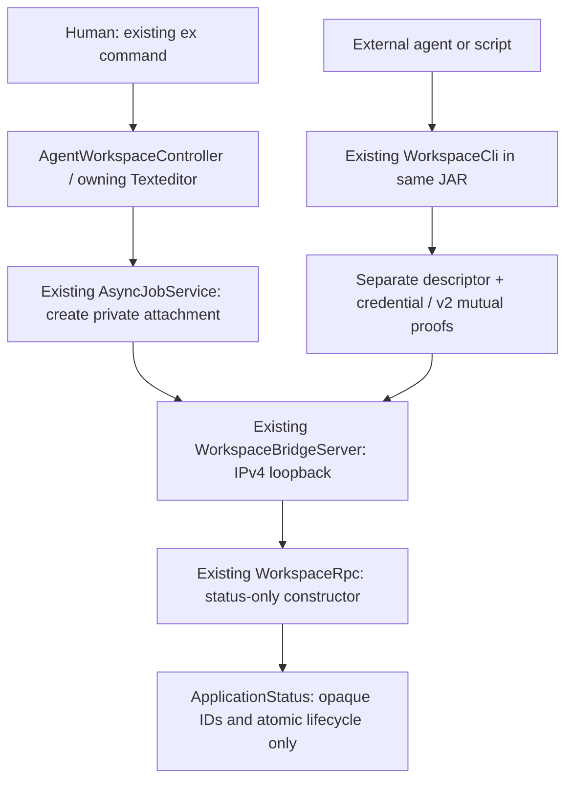

# Track A1 — Authenticated local status attachment

## A. Verdict

**PARTIAL.** The status-only production implementation, in-process contract, real loopback transport and separate headless CLI are verified within the reviewed fixture. A separate Java process successfully queried the production bridge, but its server used a plain application-status fixture, **not a running `Texteditor` window**. External attachment to a real desktop Shed instance, native startup/shutdown, Windows/Linux security behavior and whole-IDE memory remain OPEN. This is not full production-readiness acceptance.

A1 implements A0's existing-CLI/existing-bridge recommendation. No new transport, editor, document model, general command dispatcher, native library, provider integration, dependency or settings system was introduced. Status mode cannot read workspaces, files, buffers, revisions, diagnostics or panes; it cannot navigate, edit, save, render, capture or execute tools. Unknown/future methods are rejected, not registered as disabled endpoints. No A2 work was implemented.

The [evidence index](performance/agent-tracka1/INDEX.md) distinguishes initial failures, corrected runs, measurement samples, process-fixture acceptance and remaining desktop gates. Prior A0/B0/B1 evidence is preserved.

## B. Architecture implemented



Human initiation:

```text
:agent api start status
:agent api status
:agent api stop
```

The existing command feedback supplies two private file paths. An explicitly targeted external client uses:

```sh
shed --workspace-api --status --connect <descriptor-file> --credential <credential-file>
```

Only paths appear in these arguments; the secret value is read from the private credential file. No workspace root is needed or returned. The CLI requires both explicit paths and rejects `--root`, `--request` or `--stdio` in status mode. It never searches for an instance, launches Shed or silently selects an alternative endpoint. Existing workspace CLI/stdin relay behavior remains separate and is regression-tested.

`AgentWorkspaceController` continues owning one active bridge/start job per window. It refuses an incompatible active mode until stopped. Status startup takes the **status branch before any workspace-query/proposal service is constructed**. Existing `WorkspaceBridgeServer` constructors preserve the legacy workspace mode; its new status factory uses the same listener, client slots, framing infrastructure, deadlines and shutdown path. `WorkspaceRpc(ApplicationStatus)` has no workspace/proposal service and routes only `editor/status`.

`ApplicationStatus` has a process-lifetime opaque UUID, an owning-window UUID and an atomic STARTING/READY/STOPPING state. IDs/crypto/private files are initialized on the startup worker after explicit enablement. Normal application startup adds only readiness notifications to the existing controller; it creates no attachment, credential, listener or status model. Non-staged and completed staged UI assembly mark readiness. READY means that workbench UI assembly has completed; it does **not** promise that startup files, Git, recovery, language servers or all background jobs have finished.

Status queries read that atomic model entirely off the EDT. They do not capture Swing components or enqueue work on the editor. Shutdown marks an existing status model STOPPING and uses the existing controller shutdown/generation checks. No source/document/pane ownership moved.

## C. Authentication and threat model

The implemented mechanism follows [A0's nonce/HMAC design](AGENT_CONTROL_PLANE_AUDIT.md#d-transport-decision-and-attachment), using standard JDK `HmacSHA256`, `SecureRandom` and constant-time comparison of fixed-length decoded MACs. [Java's Mac API](https://docs.oracle.com/en/java/javase/21/docs/api/java.base/javax/crypto/Mac.html) supplies the primitive; [RFC 2104](https://www.rfc-editor.org/rfc/rfc2104) describes HMAC. There is no new cryptographic primitive, TLS/certificate store or native authentication framework. The application wire protocol is documented below; tests and A0's design justification are not a formal cryptographic proof or an independent external implementation audit.

### Credentials and protocol separation

Each explicit attachment generates a fresh 256-bit secret and attachment UUID. The existing session directory's `agent-api` child contains:

- `status-<attachment-UUID>.json`: version, opaque process/window/attachment IDs, port, expiry and `scope: status`; **no secret or personal path**.
- `status-<attachment-UUID>.key`: version, matching attachment ID and secret; never returned through the API or logged.

Both files use `PrivateWorkspaceFiles` owner-private creation/read checks (POSIX 0700 directory/0600 files, or the existing owner-ACL branch). Status paths reject symbolic-link ancestors and nonnormalized traversal. Storage is canonicalized and checked outside the owning window's configured roots before credential publication. Unsupported ownership/permission models fail; no fallback to a public directory or inherited credentials. Do not place private session storage inside a separately exposed project. Cross-window grants and changing project roots need additional review before any future source-reading control mode; A1 grants no project/file access.

Discovery alone cannot authenticate. The caller must explicitly supply the separate credential file; its ID must match the descriptor. A control credential never enters the legacy bearer handshake. Conversely, a schema-1 workspace descriptor is rejected by the status client before connection. The existing legacy READ/PROPOSE modes retain their previous protocol and separate keys; A1 does not claim to have hardened all legacy workspace attachments.

### Three-step mutual proof

1. Client sends `connection/hello`, targeting the descriptor's process/window/attachment IDs, protocol 2 and a fresh 32-byte client nonce.
2. Server supplies a fresh 32-byte server nonce, fresh session UUID and **server** HMAC proof. No application readiness/status is returned.
3. Client verifies that proof before sending its **client** proof. Server verifies it, rechecks expiry and sends a distinct **finish** proof. Only then are status records accepted.

Authentication envelopes use JSON-RPC 2.0 with fixed `id: attach`. Fields are strict, duplicate JSON keys are rejected, and no key value is transmitted. Role separation prevents using a server proof as a client proof in the tested reflection cases. Fresh challenges/session IDs reject replayed proofs in the covered reconnect scenarios.

The HMAC transcript is 14 fields in fixed order. Each field is a four-byte unsigned-length representation written by Java `DataOutputStream.writeInt` (big endian, bounded positive lengths here), followed by UTF-8 bytes:

```text
"shed-status-v2", role, "2", instanceId, windowId, attachmentId,
decimal-port, decimal-expiresAt, "status", clientNonce, serverNonce,
sessionId, decimal-sequence, exact-payload
```

Handshake roles are `server`, `client`, `finish`, with sequence zero and empty payload. Data roles are `request` and `response`, with increasing connection-local sequences 1–128. MACs/nonces are lowercase hexadecimal. Each data record contains exactly `sessionId`, `sequence`, `payload` (the inner JSON-RPC string) and `proof`. Thus payload bytes, role, identity, expiry, session and sequence are authenticated together. This supplies integrity, not encryption; opaque status data is not confidential against privileged packet observation. No source data is carried.

The client validates the finish proof, every response MAC/sequence, JSON-RPC ID correlation, returned process/window identity and the exact status privacy schema. It rejects extra result fields or extra capabilities. CLI errors are normalized to bounded codes/messages; they do not print arbitrary peer errors or stack traces.

### Limits of protection

The authenticated principal is possession of this attachment's secret, not a verified model, vendor, client PID or separate OS identity. A fully privileged same-user process can generally read same-user private files or memory and can impersonate a key holder. This is **not a sandbox against that process**. Owner permissions and proofs address unauthenticated peers, accidental disclosure/attachment, other-user access subject to OS permissions, stale endpoint/port reuse, tampering and the tested replay patterns. Root/administrator compromise is outside this boundary. No ACP, MCP, agent host or network service is required.

Managed key arrays and serialized credential bytes are cleared on retirement where owned; Java strings, provider-internal copies and heap dumps are not guaranteed securely erased. Logs/evidence contain public test vectors and outcome metadata, never runtime keys, nonce/proof traffic or credential-file contents.

## D. Status protocol and errors

Descriptor/authentication version is **2**; inner status schema is **1**. The existing CLI emits one bounded JSON response and exits.

Authenticated inner request:

```json
{"jsonrpc":"2.0","id":"status","method":"editor/status","params":{"schemaVersion":1}}
```

Successful inner response (example IDs only):

```json
{"jsonrpc":"2.0","id":"status","result":{"schemaVersion":1,"protocolVersion":2,"instanceId":"00000000-0000-0000-0000-000000000001","windowId":"00000000-0000-0000-0000-000000000002","readiness":"ready","authenticated":true,"capabilities":["status"]}}
```

These seven result properties are the whole schema. There are no paths, project/document names, revisions, cursor/selection/pane state, environment/user details, diagnostics, secrets or stack traces. There is no success result while STARTING or STOPPING. Status requires an explicit non-null bounded ID and exactly the `schemaVersion` parameter. No batch/notification-based status operation is accepted.

CLI failure shape:

```json
{"jsonrpc":"2.0","id":"status","error":{"code":-32000,"message":"Status attachment failed","data":{"code":"UNAUTHORIZED"}}}
```

| Condition | Stable domain code | Status CLI exit |
|---|---|---:|
| Success | No error | 0 |
| Invalid/missing/incompatible arguments | INVALID_REQUEST | 64 |
| Missing descriptor or refused connection | INSTANCE_UNAVAILABLE | 69 |
| Authentication/private-credential failure | UNAUTHORIZED | 77 |
| Unsupported descriptor/auth/status version | UNSUPPORTED_PROTOCOL | 76 |
| Invalid, closed or expired session | SESSION_INVALID / SESSION_EXPIRED | 78 |
| Workbench UI assembly not ready | APP_NOT_READY | 75 |
| Absolute/read deadline | TIMEOUT | 70 |
| Other transport/output failure | TRANSPORT_ERROR (or relevant bounded limit code) | 74 |

A missing credential file is unauthorized; a missing descriptor is unavailable. After crash cleanup has removed an expired descriptor, a fresh CLI cannot distinguish its prior expiration from absence and reports unavailable. Invalid post-authentication data can terminate the session rather than produce a trusted application reply. Unknown methods return JSON-RPC `-32601`/`UNSUPPORTED`; malformed requests have explicit errors. No fallback to an empty success or another mode occurs. Output is published after client-resource closure, avoiding a success line followed by a close-failure line.

## E. Instance targeting

There is no automatic discovery or “newest instance” selection. Both files are explicit and their identities are bound into every proof. The process ID is shared by status models in one JVM; each owning window has a different UUID. Re-enabling in the same window retains its application identity but creates a new attachment/key. A new JVM creates a new process UUID. UUIDs are opaque lifetime IDs, not project IDs or persistent document IDs.

Two simultaneous fixture endpoints, mismatched credentials/window IDs and a stale descriptor redirected to a different live endpoint were tested. A stale port cannot simply echo identifiers to satisfy the client; it must prove possession of the selected key against the fresh transcript. No exploit against a personal application was attempted. Multiple native Shed processes/windows and actual restart remain unqualified, rather than inferred from these fixtures.

## F. Lifecycle and cleanup

| Event | Implemented behavior / qualification |
|---|---|
| Ordinary startup, disabled control | No endpoint, key, polling timer or status initialization. UI-ready hooks only notify the existing controller. Native startup overhead not measured. |
| Explicit enable | Existing worker creates private files/socket; one active/start job per owner; incompatible mode requires stop. No new UI approval or persisted preference. |
| Authenticated connection | At most eight clients, bounded frames, per-connection mutual proofs and at most 128 requests. No application task backlog for status. |
| Disconnect/client crash | EOF/reset exits worker and clears connection session. Actual headless CLI exits and pipes are closed; abrupt socket departure exercises the server-side crash-equivalent path. No full desktop-client crash test. |
| Time bounds | Authentication absolute 3 seconds; status client operation absolute 3 seconds; server idle/frame absolute 5 seconds. Socket closure bounds reads and blocked writes. A transient client deadline executor exists only for client I/O; its idle core thread can time out. |
| Attachment expiration | Ten-minute wall/monotonic limit plus one-shot expiration on the existing deadline executor. No polling loop. Owned files are removed and sessions closed. Deterministic clock and timed cleanup tests pass. |
| Stop/shutdown | Existing generation/cancel/disposal ownership is reused. Stop schedules cleanup off EDT and reports stopping while it runs. Application closure marks status STOPPING. No IPC wait on EDT. |
| Closed ownership | Terminal close notification removes the endpoint from the owner registry. Its UI update holds a weak owner reference and checks disposal; the observer is consumed once, including expiration. |
| File replacement/cleanup failure | Delete only exact owned paths after existing owner/identity/content checks. Replaced content is retained and cleanup failure is reported generically. No untrusted discovery path drives deletion. |
| Application crash | Old files may remain private; expiry/identity/proof checks make them unusable for attaching to another instance. No automatic broad stale-file deletion. Actual native crash/recovery not executed. |

Status data payload is limited to 2 KiB and its signed frame to 4 KiB; authentication frames also have a 4 KiB cap. Frames require a newline; truncated EOF is rejected in status mode while legacy framing remains compatible. Private descriptor/credential reads are bounded to 4 KiB. JSON nesting is bounded by the existing strict parser. No full source/materialization, document cache or per-keystroke work was added.

One **development test failure** is preserved: the initial transport run passed 15/16 tests; timed expiration failed to delete files. Shutdown called `deadlines.shutdownNow()` from its own expiration task before file-channel cleanup, interrupting that cleanup. Moving executor shutdown after owned-file cleanup corrected the cause. The same assertion then passed, and the final profile passes. No exception was suppressed, deadline lengthened or assertion weakened. Expiration's ownership callback was also added so an expired endpoint does not accumulate in the controller's owned set.

## G. Security and integrity verification

Final contract/transport tests cover:

- Valid proofs, wrong/missing keys, invalid identity/version, wrong-instance pairing, stale port redirection and owner-permission/symlink failures.
- An independent Python `hmac`/`struct` transcript vector; role, all identity fields, expiry, nonce, payload and sequence binding; wrong server proof receives no client proof.
- Replayed client proof with a new challenge, repeated/tampered signed requests, response-ID mismatch, strict response privacy/capability checks, exact request/query/frame limits and invalid/truncated JSON.
- Unknown source/file/cursor/selection/edit/save/diagnostic/render/capture/tool/proposal commands rejected through the real authenticated transport.
- Expiry before and after authentication, slow/incomplete authentication, silent-peer client timeout, eight-client bound, repeated clients, close/reopen, replaced files, permission failure and single-consumption owner cleanup.
- A status round trip completes while the EDT is intentionally occupied. An unrelated buffer's exact source, revision, dirty flag and Undo availability remain unchanged.

The source/Undo test is a disposable document, not proof of every native window interaction. Existing admitted document, recovery, keymap, source-view, gutter, glyph, LSP, theme, focus/centering and density tests also pass. No source editing/navigation endpoint or general command executor exists in status mode.

## H. Performance and resource evidence

Current-host, fresh-JVM opt-in probe uses the existing JDK 21/Maven fixture, real loopback bridge and in-memory production text-area UI. JVM heap/graphics settings were not tuned for this measurement. Raw samples and an earlier diagnostic run remain preserved. The final extended probe adds named-thread CPU/compiler attribution because early whole-JVM idle intervals contained significant compiler activity; those earlier intervals were not discarded or reclassified as zero CPU.

| Metric | Final extended probe |
|---|---:|
| First status model/factory/private-file publication | 36.69 ms, worker operation |
| First client file validation/connect/authentication | 17.24 ms |
| First status round trip | 2.55 ms |
| Warm status (80 samples) p50 / p95 / observed p99 | 0.408 / 0.714 / 0.873 ms |
| Later factory publication p95 (23 warm cycles) | 17.47 ms |
| Later complete client attach p95 (23 warm cycles) | 6.374 ms |
| Server close + owned-file cleanup p95 (23 warm cycles) | 1.492 ms |
| 1 MiB ASCII control typing → completed component paint, first / warm p95 (50) | 48.92 / 0.780 ms |
| Same component with synchronized concurrent status requests, first / warm p95 (50) | 0.806 / 1.941 ms |
| Retention after 24 create/attach/query/dispose cycles | 0/48 application/server weak references retained; 0 named attachment threads |

Small cycle percentile estimates are directional, not population tail guarantees. Typing control ran first; the traffic workload benefited from initialized font/layout state. The final traffic p95 was 1.161 ms higher than its paired control; both meet 16 ms in this supported component workload. Earlier probes varied and are preserved; no statistically universal latency-equivalence or improvement claim follows. The 48.92 ms first control paint and traffic maximum 3.68 ms are reported separately. No Unicode first-edit or preview-layout problem is claimed resolved.

Warm settled snapshots: enabled/disabled used heap **22,307,104 / 22,307,664 bytes**, committed heap 77,594,624 bytes in both; threads **23 / 21**, named attachment threads **2 / 0**, open descriptors **180 / 179**. The 560-byte heap difference is harness noise, not proof of whole-IDE memory equivalence or an exact incremental allocation budget. Initial first-use observations had 6 total JVM threads/175 descriptors; later disposed state had 21/179. That residual first-use increase is **unattributed**, includes broader JVM/Swing initialization, and does not disappear merely because tracked objects are collectable. Total counts stayed stable across the 24 cycles. RSS/native-memory attribution was not measured.

Three warmed enabled idle windows (~200 ms each) recorded **0 ns CPU on named attachment platform threads**. Whole-JVM CPU was 1.292 / 0.313 / 0.092 ms; disabled warm samples were 0.319 / 1.591 / 0.151 ms. All six final settled windows recorded zero compiler-time growth. The earlier final-run enabled interval recorded 25.964 ms of whole-JVM CPU and 32 ms of compiler-time growth, with zero named-attachment CPU; it remains in the raw data. These short Maven-hosted observations support parked endpoint threads in the measured interval, not a native IDE idle-CPU guarantee.

Earlier separate CLI-process runs observed 110–122 ms including Java startup and full attach/query/exit; final regression samples are also preserved. They are fresh processes, not cold filesystem-cache runs or authentication-only latency. Native startup/time-to-input, graphical idle process memory/RSS, OS focus, real main-window enable/stop latency and Windows/Linux performance remain unmeasured.

## I. Regression results and commands

The admitted safe profile currently runs **248 cases: 244 passed, four opt-in measurement skips, zero failures/errors**, across 52 selected classes. Skips are LSP, gutter, glyph and status measurement classes. The opt-in status probe separately passed one test. **87 Python tooling tests passed**. No historical full-suite total is substituted for these actual results.

```sh
PYTHONDONTWRITEBYTECODE=1 python3 scripts/run-portable-tests.py \
  --jdk /tmp/shed-tranche2b-tools/jdk-21.0.13+9/Contents/Home \
  --maven /tmp/shed-tranche2b-tools/apache-maven-3.9.11 \
  --repository /Users/gongahkia/.m2/repository \
  --output <new-evidence-file>
```

Use the same runner with `--tests WorkspaceStatusMeasurementTest --measure-status` for the bounded opt-in measurement, or `--package-only` for safe packaging. Exact expanded commands/logs are archived. Python discovery ran under a fresh `native_fixture.Fixture` environment with Python user-site and bytecode output disabled. Staged A/B/C runs and the failed/corrected expiration run are indexed separately; do not sum repeated passes into the final count.

Admission was extended only after reviewing transitive behavior. In-process RPC/private-file tests have no process launch. Existing CLI/bridge tests now use a **test-only fixed Java CLI launcher**, not a shell: it validates the disposable context, restricts main/arguments and paths, constructs classpath only from reviewed build/copied dependencies, clears inherited environment, sets native/JVM home/temp/preferences, fixes working directory and closes/waits for its owned child. Helper source hashes are checked before Java launch and by JUnit; native/unknown classes remain rejected. Original CLI/bridge assertions are unchanged. This is trusted-code execution admission, **not an OS sandbox for arbitrary Java**.

Full native/GUI/PTY suites, real language servers, providers, interactive shells and the B0.1 native benchmark path were not run. The native confinement positive control remains failed. Main-window command/readiness/close hooks are source-inspected and component-supported, not desktop-accepted. Packaged-media result and final static/compliance checks are recorded in the evidence index; neither implies real-window control acceptance.

## J. External-process acceptance

**Verified:** a separate bounded Java process ran the real `shed.Texteditor --workspace-api --status …` CLI path, mutually authenticated against the real production bridge, checked status identity, exited successfully, disconnected and left the synthetic external sentinel's bytes and modification time unchanged. An unauthorized separate client exited 77 with no private status/path output. Existing headless workspace CLI/bridge regressions also ran through this guarded launcher.

**Not verified:** a separate process attached to a normally started, real desktop Shed window and exercised its actual human enable/stop workflow. The server status host in these tests is an `ApplicationStatus` fixture. No window was launched; no desktop automation/capture or unsafe shell fixture was substituted. That acceptance gate stays **OPEN**. Closing it needs a separately admitted isolated real-application startup configuration, explicit existing-command activation, controlled CLI/identity/status/stop and bounded shutdown, including configured background-service side effects. Do not infer safety from “Java process” alone or bypass B0.1.

## K. File inventory

| Category | Files / rationale |
|---|---|
| New production | `ApplicationStatus.java` — bounded atomic lifecycle; `WorkspaceStatusAttachment.java` — ephemeral private descriptor/key ownership; `WorkspaceStatusProtocol.java` — A0 mutual proofs and authenticated records. |
| Existing production | `AgentWorkspaceController.java` — explicit mode/ownership; `Texteditor.java` — two UI-ready notifications; `HelpService.java` — one existing-help sentence; `WorkspaceApiException.java` — status codes; `WorkspaceBridgeServer.java`, `WorkspaceBridgeClient.java`, `WorkspaceCli.java`, `WorkspaceFrames.java`, `WorkspaceRpc.java` — narrow extensions to existing boundaries. |
| New tests/helper | `WorkspaceStatusContractTest.java`, `WorkspaceStatusTransportTest.java`, `WorkspaceStatusProcessTest.java`, `WorkspaceStatusMeasurementTest.java`, `WorkspaceCliProcessGuardTest.java`, `WorkspaceCliTestProcess.java`. |
| Existing tests/safety | `WorkspaceCliTest.java`, `WorkspaceBridgeTest.java` — guarded launch/cleanup only; `NativeFixtureGate.java` — helper hash checks; `portable-fixture-tests.properties` and new `portable-fixture-helpers.properties` — reviewed sources. |
| Tooling | `scripts/run-portable-tests.py` — helper admission and opt-in measurement; `scripts/test_native_fixture.py` — exact new manifest entries/helper hashes and option-exclusion check. |
| Documentation/evidence | `docs/AGENT_WORKSPACE.md`, this report, new `docs/performance/agent-tracka1/` files enumerated by its index and checksums. |

No production dependencies, font/theme defaults, saved-preference format, document/Undo implementation, editor layout or rendering component changed. No new panel, setting, chat interface or control was added. Existing command/help feedback is reused.

## L. Repository compliance

Starting HEAD: `4852f154386a3e54d4ff8cf5da426c28bbd38bce`. Existing untracked A0 report/evidence were preserved. Before modification, 2,131 existing input hashes were recorded, including README and that user work. Final changed-file inventory, unrelated-file preservation, HEAD/status and whitespace checks are in `repository-verification.json` in the evidence directory. The agent created no commits or pushes; any external capture commits are recorded separately.

README before/after SHA-256:

```text
48bf87f09ffa570b7fc65d305a15c3228bbc67e906cc992e4fe7108893e7501e
```

All explicit test writes use disposable native/JVM homes, preferences, work/temp directories or authorized build output. Synthetic external sentinel checks cover byte content and metadata; no personal shell-history/configuration contents were inspected or restored. These checks do not claim kernel confinement or universal absence of OS cache activity. No reset, clean, revert, commit, push or broad process kill was performed.

## M. Remaining limitations

- Actual desktop Shed attachment, real enable/stop/readiness/shutdown/crash/restart and multi-window acceptance are open.
- macOS headless/local-filesystem tests do not qualify Windows ACLs/reparse points, Linux GUI/security behavior, network filesystems, packaging launchers or native resource costs. Unsupported permissions fail closed; manual startup remains available. No separate platform implementation was introduced.
- No auto-discovery, reconnect, launch, credential renewal or automatic crash-file scavenging. Explicit re-enable creates a fresh ten-minute grant. Private crash leftovers are inert/expired, not automatically deleted by untrusted metadata.
- Authentication depends on secret possession and the existing owner-private filesystem trust model, not same-user sandboxing. Legacy workspace protocol hardening and broader cross-window secret-path policy remain separate concerns before granting source access.
- No independent external cryptographic implementation review or formal proof; retain a review gate before expanding authority. Short idle/heap samples, zero tracked weak references and stable counters are not native-memory or whole-IDE release qualification.
- Existing glyph fallback, Unicode conformance/first-edit, HTML-preview stalls and native-shell NO-GO remain unchanged. Native media/regression smoke is not desktop control acceptance.

## N. Next bounded recommendation

First close the **A1 real-window acceptance gate** through an independently safe isolated fixture; do not replace it with a mocked window or relax native-shell safeguards. Review the version-2 protocol and platform permission matrix before broadening capabilities.

The smallest subsequent A2 slice is bounded, explicitly granted **read-only application/editor metadata** using targeted existing document-store access, never `EditorWorkspaceDocuments.snapshots()` for high-frequency enumeration. Keep A1 credentials status-only; a new metadata grant needs explicit consent, root/document lifetime identity, bounded pagination, raw-source versus opaque-version distinction and private/scratch exclusion. Source excerpts and pane/context/navigation operations need separate permissions and proof gates. No cursor, source edit, preview, capture, tool, ACP or MCP implementation follows automatically from this report.
