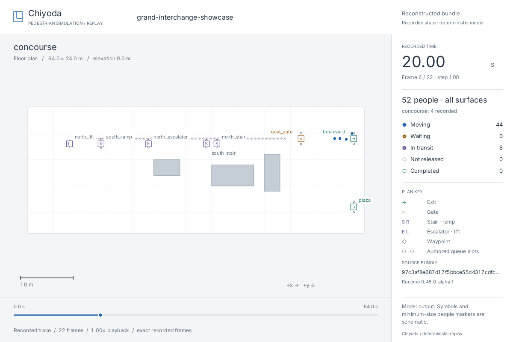

# Native replay viewer

`chiyoda-replay` is a local native viewer for either a hash-valid `run.json`
artifact or an in-memory live JSON scenario run. It visualizes the reference
runtime's recorded state; it is not a simulation engine, a facility survey, a
3D renderer, or an operational display.

```console
$ cargo run -p chiyoda-replay -- out/showcase/run.json --paused
$ cargo run -p chiyoda-replay -- out/showcase/run.json --surface concourse
$ cargo run -p chiyoda-replay -- out/showcase/run.json --speed 10
$ cargo run -p chiyoda-replay -- out/showcase/run.json --surface concourse --export-gif out/showcase/replay.gif --gif-speed 4
```

`--at-step N` starts at an exact recorded integration step. It can be combined
with `--paused` and `--surface` for the replay moments linked from
[journey diagnostics](journeys.md). A missing recorded step is rejected; the
viewer does not invent an interpolated diagnostic frame. The option applies
to saved bundles, including PNG export, rather than live watching or GIF export.

## Live JSON debugging

For the editing loop, pass a source file through `--watch` instead of a run
bundle:

```console
$ cargo run -p chiyoda-replay -- --watch examples/demos/grand-interchange-showcase.json
$ cargo run -p chiyoda-replay -- --watch draft.json --paused --surface platform --trace-every 1
```

The viewer polls saved source text, waits 150 ms for writes to settle, then
loads, validates, and executes the complete deterministic scenario on a
background worker. A newer save supersedes a stale worker result. A successful
revision atomically replaces the displayed trace at simulation time zero; it
does not mutate a running simulation. The default watch trace cadence is one
integration step, which affects display smoothness only.

An invalid edit leaves the most recent valid scene and trace on screen. The
terminal prints the complete JSON, validation, or runtime diagnostic; the
window and an in-canvas diagnostic panel identify the failed revision. Before
the first valid source revision, the viewer displays an empty debug canvas with
the current status and any read error.

Watch runs are intentionally in-memory, unpersisted debug results. They are
not hash-verified bundles and cannot be cited as a replayable experiment
artifact. Run `chiyoda run SOURCE -o DIRECTORY` separately when a durable,
hash-verified JSON bundle is needed.

For a bundle made by the installed runtime, the viewer checks the bundle hash
and reconstructs the complete deterministic run before opening a window. It
rejects an incompatible legacy runtime by default; `--allow-legacy-hash-only`
permits display after hash verification alone and emits a warning. The CLI also
rejects an unknown initial surface and an empty trace. Interactive playback
requires an available native display. PNG and GIF exports do not open a window.

For locally aware groups, `run.json` also retains each agent's familiar exits
and learned availability with its time and source. `resource_observed` and
information events explain changes. The viewer displays the resulting movement;
select the person to inspect recorded decisions and export its knowledge
snapshot as structured evidence. These fields are
included in full reconstruction; see [local knowledge](knowledge.md).

## Controls

- Click a person to inspect it; Shift-click an exit, gate, connector endpoint,
  or waypoint to prefer the resource. Click empty plan space to clear selection.
- Wheel or `+`/`-` zooms. Wheel zoom keeps the point under the pointer fixed.
  Drag with the right or middle button to pan. R restores the authored extent;
  F focuses the selected person or resource.
- Click or drag the timeline to seek and pause at a recorded frame.
- Space toggles playback; at the end, it starts again from the beginning.
- Left and right arrows pause and step to the adjacent recorded frame.
- `[` and `]` halve and double playback speed.
- Tab cycles surfaces in their authored declaration order. In comparisons,
  only IDs present in both runs are available.
- V toggles the selected-surface 2D view and all-surface isometric overview.
- D toggles the inspector/source details in the fixed sidebar. Playback time,
  frame, step, counts, and the plan key remain visible.
- P writes the current framebuffer as a PNG under `--snapshot-dir` (default
  `out/chiyoda-replay`). Existing snapshots are preserved. For evidence with
  provenance, use `--export-png` instead.
- Escape closes the viewer.

The camera starts at authored surface bounds and stays stable while replaying.
`--zoom N --pan-x X --pan-y Y` sets its initial transform; pan values are
framebuffer pixels. Zoom is bounded to 0.25–32×. By default playback advances
according to recorded simulation time. `--speed N` shows `N` simulation seconds
per wall-clock second. If drawing cannot keep up, interactive playback skips
display frames to catch up; it never interpolates people between stored states.
GIF export still renders every stored frame.

## Inspect people and resources

```console
$ chiyoda-replay out/station/arms/baseline/run.json --paused --at-step 100 --agent passengers:4
$ chiyoda-replay out/station/arms/baseline/run.json --paused --resource exit:south
```

The person inspector shows recorded state, the authored goal, latest recorded
route decision, recent information/service events, and whole-run journey totals.
Structured evidence also retains the recorded beliefs/knowledge snapshot. The authored destination is not presented as the
current chosen destination. Where the runtime recorded a decision in event
text, that text is retained without inventing an unrecorded route.

A selected person's trail joins consecutive recorded positions through the
selected frame. It omits inactive and connector-transit segments. The last
2,000 points are retained; `--trail-start-step N` can narrow the interval in a
single-run view.
Comparisons use each selected person's retained trail through its own frame.
A trail is a sampled visual aid, not the distance measurement. Amber timeline
bands show retained whole-run low-progress windows; ticks show retained
recorded events through the frame.

Detailed distance, moving time, service waits, authored pauses, low-progress
windows and movement fallback counts require the current runtime and a trace
recorded with `--trace-every 1`. Sparse traces still support positions and
recorded events, with an explicit unavailable reason for detailed accounting.
Inspection re-derives journey accounting with the default analyzer options and
records those options and the derived report hash. Separate journey reports
with custom thresholds or isolated-agent controls retain their own evidence;
the inspector does not import those controls. Whole-run totals and low-progress
windows include the complete run, even when viewing an earlier frame. Low progress is a diagnostic of movement exposure,
not an additional mutually exclusive time-budget category.

Resource inspection shows authored geometry, whole-run queue audit measurements,
and recorded queue/service/availability events through the selected frame.
Highlighted entrants are historical entrants through that time, not inferred
current queue membership. The runtime does not record resource-attributed
per-person wait durations; the viewer does not estimate them from proximity.
See [journey diagnostics](journeys.md) for the accounting definitions.

## Compare runs

```console
$ chiyoda-replay out/station/arms/baseline/run.json --compare out/station/arms/announcement/run.json --paused --at-time 20 --agent passengers:4
$ chiyoda-replay out/station/arms/baseline/run.json --compare out/station/arms/announcement/run.json --at-time 20 --export-png out/station/comparison.png
```

Both panels share one camera, authored coordinate extent, selected surface ID,
and simulation clock. Different floor dimensions therefore keep the same metric
scale. At a shared time, each panel shows its last recorded frame at or before
that time; its exact timestamp and any hold duration remain visible. Seeking is
restricted to the intersection of the recorded intervals. Missing surface IDs
are rejected rather than matched by declaration order.

Current-frame completion counts are separate from whole-run outcomes. The latter
retain each run's own duration. Unfinished clearance and elapsed journeys remain
unavailable. Population pairing requires equal seed and authored population
inputs, excluding the knowledge intervention; a changed population disables
individual elapsed-time pairing. A selected ID absent from one run is labelled
unavailable in that panel. These are descriptive model observations; use the
experiment report's validity and performance checks to assess an intervention.

Zoom, pan, timeline seeking, speed, projection, floor selection and person/resource
selection operate together across both panels. Labels come from the input
bundles' parent directory names. The PNG and `PATH.json` comparison sidecar use
`chiyoda.replay-comparison.v1`, with both source hashes, shared camera bounds,
recorded timestamps, request, selected evidence and measured differences.

## Exact-frame PNG export

`--export-png PATH` writes a reviewed frame without opening a window. Use
`--at-step N` for an exact recorded step; otherwise it exports the first frame.
`--surface ID` selects a floor and `--view overview` projects every floor.
The same `--view` option selects the initial interactive or GIF projection.

```console
$ cargo run -p chiyoda-replay -- out/showcase/run.json --at-step 100 --export-png out/showcase/frame.png
$ cargo run -p chiyoda-replay -- out/showcase/run.json --view overview --export-png out/showcase/overview.png
```

The image and its `PATH.json` sidecar require a reconstructed bundle. The
sidecar records its source hashes, runtime contract, selected surface and
explicit list of rendered surfaces,
projection, camera transform, exact recorded step and timestamp, and image dimensions.
Plain frame exports use `chiyoda.replay-png.v2`. Existing
images and sidecars are never overwritten. PNG and GIF export are mutually
exclusive and cannot watch live source.

Add `--agent ID` or `--resource KIND:ID` to export an annotated frame. The
`chiyoda.replay-evidence.v1` sidecar includes the exact evidence used to draw the
inspector, image SHA-256, source hashes, recorded timestamp, JSON pointers,
journey analyzer version/options/report hash, bounded events and trail. The
native viewer and headless export share the same renderer.

```console
$ chiyoda-replay out/station/arms/baseline/run.json --agent passengers:4 --at-step 100 --trail-start-step 50 --export-png out/station/person.png
$ chiyoda-replay out/station/arms/baseline/run.json --resource exit:south --at-step 100 --export-png out/station/exit.png
```

Agents can request the same image and structured evidence through
[`chiyoda_render_evidence`](agent-experiments.md#annotated-replay-evidence).
Annotated selections, comparison and transformed cameras are currently PNG/native
features; the GIF path retains its ordinary full-run presentation.

## Animated GIF export

PNG snapshots remain the smallest and clearest artifact for a single reviewed
state. Use an animated GIF only when the sequence itself matters—for example,
to review movement timing, queue-state transitions, or rerouting. `--export-gif
PATH` verifies and reconstructs the input bundle before rendering every stored
trace frame of the selected projection, writes `PATH`, then exits without opening a
window. It never accepts `--watch`, does not re-run or load a scenario, and does
not modify the canonical bundle.

`--gif-speed N` means `N` simulation seconds per playback second. GIF timing is
limited to centiseconds; the companion `PATH.json` records the exact
per-frame rounded delays, the terminal-delay policy, playback speed,
`trace_every_steps`, trace-frame count, selected and rendered surfaces, scenario hash, bundle
hash, runtime and bundle versions, projection, and a clear derived-artifact boundary.
The GIF sidecar uses `chiyoda.replay-gif.v2`. The exporter refuses to overwrite either the GIF or its sidecar. The verified JSON
bundle remains the canonical replay and timing artifact.

GIFs share one palette across the animation. Status colours are preserved
exactly, while antialiased edge colours are quantized to coverage ramps. Use
PNG when the finest text and edge detail matter.

## Preview



The same recorded moment is available as an [isometric overview](../assets/demo/replay-overview.png).
Both PNGs and the [showcase GIF](../assets/demo/grand-interchange-showcase.gif)
have adjacent JSON provenance sidecars. They were exported from the current
runtime's `grand-interchange-showcase` run, with a trace cadence of 20 steps.
Their sidecars retain the renderer revision used for those earlier previews.

The station experiment also has current annotated examples: a
[person and low-progress periods](../assets/demo/replay-person.png), a
[resource queue audit](../assets/demo/replay-resource.png), and a
[synchronized comparison](../assets/demo/replay-comparison.png). Each PNG has
an adjacent `PNG.json` sidecar. Reproduce the source runs with
`python3 examples/experiments/compare_station.py --output out/station --replay`,
then use the inspection and comparison export commands above.

To reproduce the source and export a reviewed frame:

```console
$ chiyoda run examples/demos/grand-interchange-showcase.json -o out/showcase --trace-every 20
$ chiyoda-replay out/showcase/run.json --surface concourse --at-step 100 --export-png out/showcase/frame.png
$ chiyoda-replay out/showcase/run.json --surface concourse --at-step 100 --view overview --export-png out/showcase/overview.png
```

## Visual presentation

The viewer uses one 1200×800 CPU vector renderer for native playback, PNGs,
and GIFs. The plan, run sidebar, and timeline occupy separate regions. Spatial
layers are clipped to the plan viewport, including markers outside the camera
extent. Watch failures retain the last valid plan and identify the failed
revision below it and in the sidebar.

Floor plans preserve metric proportions with a uniform scale, a quiet metric
grid, and a scale bar. The camera follows authored surface bounds rather than
people's current positions. The overview uses the same fixed isometric
projection for every surface and labels their authored elevations; overlapping
floors can occlude geometry, so use a floor plan for detailed inspection.

Text uses a bundled Inter font under its included SIL Open Font License;
no font installation or network connection is required. Timestamps and counts
use tabular digits. Long names are ellipsized, and unavailable glyphs display
as `?`. This is basic font rasterization, not a full text-shaping system.
Resource labels are placed where space permits; dense plans may omit a label
while retaining its symbol. Connector symbols identify stairs (`S`), ramps
(`R`), escalators (`E`), and lifts (`L`).

The header distinguishes reconstructed bundles, legacy hash-only artifacts,
and unpersisted live previews. Export sidecars record the renderer version and
bundled font hash. The renderer is a derived presentation contract; changes to
its pixels do not change canonical simulation evidence.

## Rendering contract

For the selected surface the viewer draws its rectangular walkable boundary,
rectangular obstacles, line-footprint or serpentine-grid queue paths and slot centres, waypoints, exits,
gates, portal-lane centres, and the endpoint of every authored stair, ramp,
escalator, or lift on that surface. Agents are drawn only
when their recorded `surface` matches the selected surface. Moving agents are
blue, all released waits amber, in-transit agents purple, unreleased people
hollow grey, and completed journeys hollow green. Moving people use filled
circles; waits carry a small horizontal mark and transit markers a white centre.
Inactive records are drawn first so an unreleased or completed record does not
cover an active person at a shared position. Counts always include every
recorded person, including inactive records. The sidebar reports all-surface
state totals separately from the selected-surface count.

People markers follow their authored group radius, with a 2.5-pixel minimum for
legibility. Symbol outlines, minimum-size markers, and resource glyphs are
schematic; their screen sizes do not measure crowd density or portal width.
Static symbols distinguish waypoints, exits, gates, connector class, portal-lane
centres, and queue geometry. The queue path and slots are authored placement
geometry, not a measured queue, a claimed standing obstruction, or a density
visualization.

Connector endpoints are visual cues, not surveyed shapes or a claim that the
space between floors is visible from above. During a connector traversal the
runtime records the agent on its originating surface until arrival; a
floor-specific view therefore shows the recorded horizontal interpolation on
that origin surface. This is trace provenance, not a physical 3D position.

The viewer renders only values explicitly authored in the scenario and recorded
in the bundle. It does not infer floor plans, building boundaries, indoor
connectivity, elevations, widths, density, hazards, visibility, accessibility,
capacity, or behavior from a run.

The isometric overview is a fixed projection of authored surface elevations,
static geometry, connectors, and recorded agent positions. It is a debugging
aid, not a general 3D camera, a physical view of a station, or a new rendering
engine. The selected-surface 2D view remains the detailed rendering of queues,
portal lanes, obstacles, and resource markers.

## Performance and native verification

The shared renderer is usable without minifb: build its library with
`cargo check -p chiyoda-replay --lib --no-default-features`. The ordinary Chiyoda
CLI and MCP tool use this headless dependency. Native window support is the
replay crate's default feature and is required for its binary.

A reproducible CPU-only crowd measurement is available:

```console
$ cargo run --release -p chiyoda-replay --example render_benchmark --no-default-features -- 1000 60
$ cargo run --release -p chiyoda-replay --example render_benchmark --no-default-features -- 5000 60
```

It reports steady-state median and p95 rendering time at 1200×800, including
framebuffer copy and excluding simulation, verification and native presentation.
Set `CHIYODA_REPLAY_PROFILE=1` when opening a native replay to print redraw and
window-presentation measurements on graceful exit. The viewer targets 30 window
updates per second. Paused/unchanged ordinary
frames reuse the last rendered buffer; the window continues processing input.

On macOS, `scripts/replay_native_smoke.py --help` describes a repeatable check
using OS keyboard/mouse events and Accessibility window inspection. It requires
existing Accessibility access and Xcode tools, opens its own viewer, writes a new
review directory, and restores the prior frontmost application and pointer.
See the [inspection review](inspectable-replay-review.md) for measured results,
reviewed outputs and verification limits.
